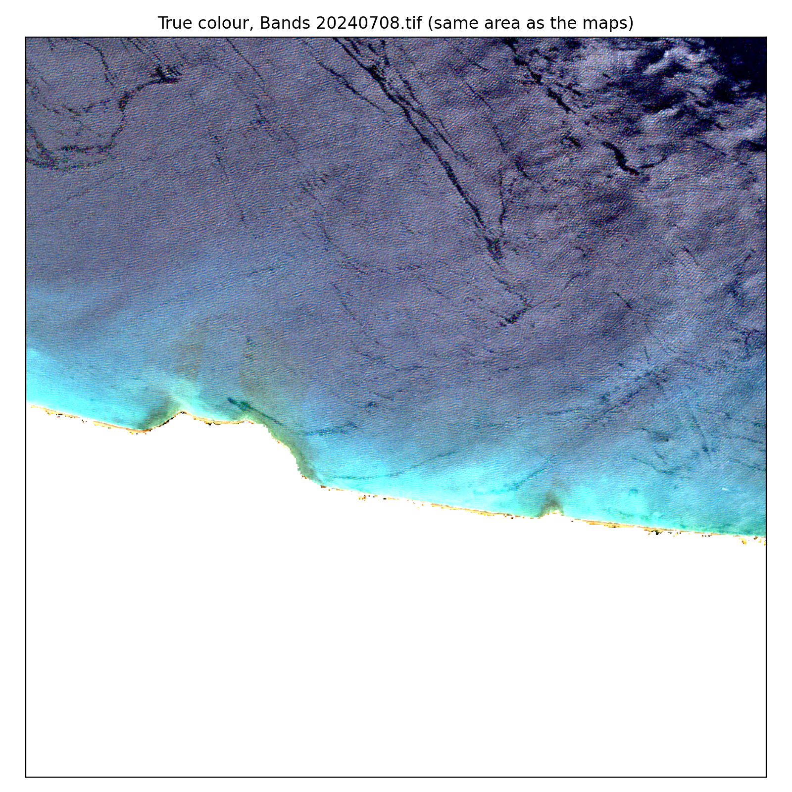
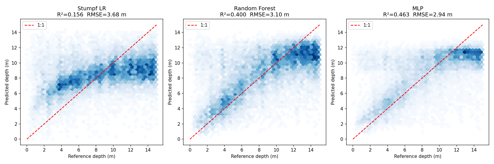
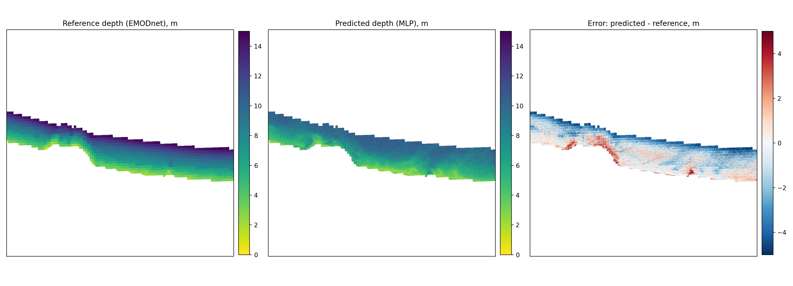

# Sentinel-2 Water Quality and Bathymetry Estimation

A satellite-based pipeline for estimating **coastal water depth** and **water quality parameters** from Sentinel-2 multispectral imagery over the south coast of Crete, Greece.

The project compares traditional spectral ratio methods against machine learning approaches (Random Forest, MLP Neural Network) for satellite-derived bathymetry (SDB), and computes water quality indices (chlorophyll-a, turbidity, NDWI) across a two-year multi-temporal dataset.

---

## Study Area

**South coast of Crete, Greece** — Sentinel-2 tile T34SGE  
Coordinate system: EPSG:32634 | Resolution: 10m | Period: 2024–2025


*True color RGB composite — Sentinel-2, March 2024. Snow visible on the White Mountains (Lefka Ori). Clear Mediterranean water ideal for optical bathymetry.*

---

## Project Structure

```
sentinel2-water-quality-bathymetry/
├── notebooks/
│   ├── 01_data_download.ipynb          # Copernicus API scene search and download
│   ├── 02_preprocessing.ipynb          # Band processing, water masking, glint correction
│   └── 03_bathymetry_baseline.ipynb    # Baseline + ML bathymetry comparison
├── src/
│   ├── water_prepro_utils.py           # Full preprocessing pipeline
│   └── visualization.py               # Plotting functions
├── tests/
├── requirements.txt
├── Dockerfile
└── README.md
```

---

## Preprocessing Pipeline

Each Sentinel-2 scene goes through the following steps:

```
Raw .SAFE file
      ↓
1. Band extraction       B02 (Blue), B03 (Green), B04 (Red), B08 (NIR)
      ↓
2. DN → Reflectance      divide by 10,000 (ESA quantification value)
      ↓
3. SCL water mask        keep only SCL class 6 (water pixels)
      ↓
4. 20m → 10m resample   SCL resampled via nearest neighbour
      ↓
5. Sun glint correction  subtract 50% of NIR from visible bands
      ↓
6. Combined mask         keep only pixels valid across all bands
      ↓
7. Index calculation     NDWI, Turbidity (Dogliotti 2015), Chlorophyll (OC2)
      ↓
Save: bands.tif + indices.tif + RGB preview
```

**54 scenes processed** | ~79% valid water pixels per scene after masking

## Bathymetry — Methods Compared

Reference depth data: **EMODnet DTM** (~115m resolution), reprojected to match Sentinel-2 grid (EPSG:32634, 10m).

Shallow water training pixels: **94,448,695** (across 54 scenes, 0–30m depth)  
Train/test split: **80/20**, stratified by scene

### Baseline — Stumpf Band Ratio (2003)

$$ratio = \frac{\ln(Blue)}{\ln(Green)}$$

$$depth = m_0 + m_1 \cdot ratio$$

Linear regression calibrated against EMODnet reference depth.


### Machine Learning Models

**Random Forest** — 100 trees, trained on 1M sampled pixels  
Input features: B02, B03, B04 reflectance values per pixel

**MLP Neural Network** — architecture: 3 → 64 → 32 → 16 → 1  
Activation: ReLU | Scaled inputs (StandardScaler)

---

## Results

Held-out blocks, single split, single seed, depth range 0–15 m.

| Model | Inputs | R² | RMSE (m) | MAE (m) |
|---|---|---|---|---|
| Stumpf band ratio | ln(B02)/ln(B03) | 0.156 | 3.68 | 3.02 |
| Random Forest | B02, B03, B04 | 0.400 | 3.10 | 2.34 |
| MLP | B02, B03, B04 | 0.463 | 2.94 | 2.20 |



### Error by depth bin

Bias is prediction minus reference, so positive values mean over-prediction.

| Depth | Test pixels | RF bias | RF MAE | MLP bias | MLP MAE | MLP median abs. error |
|---|---|---|---|---|---|---|
| 0–3 m | 196,087 | +3.28 | 3.41 | +3.29 | 3.37 | 1.70 |
| 3–6 m | 429,360 | +1.72 | 2.25 | +1.70 | 2.16 | 1.41 |
| 6–9 m | 394,816 | +0.90 | 1.93 | +0.91 | 1.82 | 1.59 |
| 9–12 m | 448,196 | −0.57 | 1.54 | −0.52 | 1.28 | 0.96 |
| 12–15 m | 529,361 | −2.96 | 2.99 | −2.86 | 2.87 | 2.71 |

Errors are smallest between about 6 and 12 m. The sign change of the bias is the usual regression towards the mean of a noisy predictor, combined with signal saturation: beyond about 12 m the predictions flatten at 11–12 m. In the first 3 m the mean error (+3.3 m) is much larger than the median (1.7 m), which points to a tail of shallow pixels that look like deep water (dark seabed such as seagrass or rock).

### Depth maps for one scene

Sentinel-2 scene of 8 July 2024, shown as a 10 km × 10 km crop around the area with the most 0–15 m pixels. First the scene in true colour (from the corrected, glint-reduced bands; white pixels are masked land or cloud), then the EMODnet reference depth, the MLP prediction and the difference between them.




In the two depth maps yellow is shallow and purple is deep, with the same colour scale. In the error map red means the model predicts too deep and blue too shallow. The map is made from a single scene, so it is noisy at pixel level, and it covers all blocks, including the ones used for training. The notebook has a switch (`ONLY_TEST_BLOCKS`) to show only held-out blocks. Only pixels inside the 0–15 m reference mask are predicted.

### Signal versus depth

For the per-pixel median over 54 scenes, ln(B03) decreases with depth (Spearman ρ = −0.61 over 1.97 million pixels) from about −2.8 at 0–2 m to about −3.8 at 18–20 m, and stays flat beyond that. This matches the expected limit of optical penetration in clear water, and the models gain nothing from pixels deeper than about 15–20 m.

### Feature importance (Random Forest)

B03 (green) 0.47, B04 (red) 0.28, B02 (blue) 0.25.

## Limitations

- **Reference resolution.** Labels come from a grid of about 116 m, applied to 10 m pixels. Within one EMODnet cell, depth is constant by construction, so real small-scale seabed relief cannot be learned or evaluated.
- **Reference quality.** Where EMODnet is filled from GEBCO the labels are coarser still. This has not been mapped.
- **No in-situ or lidar validation.** All scores are agreement with another gridded product, not with surveyed depth.
- **Single site, one split, one seed.** No confidence intervals and no transfer test to other areas or years.
- **Depth range.** Only 0–15 m is modelled. Predictions flatten beyond about 12 m, and a separate deep-water mask would be needed for use outside that range.
- **Substrate.** Dark shallow bottoms are confused with deep water, which causes over-prediction at 0–3 m.
- **Single-scene pixels.** The models use individual scene pixels pooled over 54 scenes, with no temporal compositing. A per-pixel median is expected to reduce wave, glint and turbidity noise.
- **Reflectance correction.** The −0.05 correction is applied at load time (see Preprocessing), not in the saved band files.
- **Water-quality indices.** NDWI, turbidity and chlorophyll-a depend on the same reflectances and are being recomputed. The turbidity and chlorophyll coefficients also need checking against the original papers.

## Repository

| File | Purpose |
|---|---|
| `01_data_download.ipynb` | Download Sentinel-2 scenes |
| `02_preprocessing.ipynb` | Reflectance, masks, glint correction, band stacks |
| `bathymetry_reference_prepro.ipynb` | Clip EMODnet tile, reproject to the Sentinel-2 grid, write block IDs |
| `bathymetry_baseline_stumpf_LR.ipynb` | Spatial split, Stumpf baseline, Random Forest, MLP, evaluation, depth maps |
| `docs/images/` | `bathymetry_comparison.png`, `bathymetry_map.png`, `scene_rgb.png` |

## Next steps

- Per-pixel median composite over scenes, and log-ratio features for the Random Forest and MLP.
- Validation against ICESat-2 photon bathymetry (ATL24) instead of a gridded product.
- Apply the reflectance offset in the preprocessing notebook and recompute the water-quality indices.
- Spatial cross-validation (mean ± std over folds) instead of a single split.
